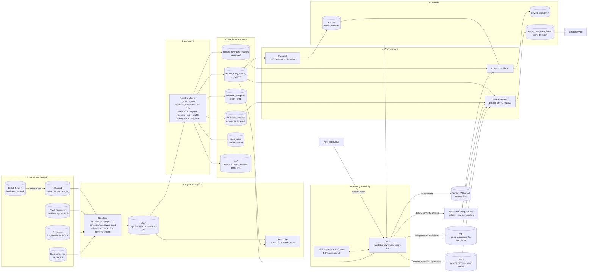

# 3.2 Data processing flow

> **Approved architecture: the R1 design baseline (DEC-006).** Approved by the Cash Intelligence architecture owner on 2026-11-05, after the 2026-11-03 design review. Generated specs follow it; a spec that needs something different is a change here first (GOV-CI-004 in `projects/branch-automation-cash-intelligence/05-delivery/delivery-model-and-gates.md`). Open questions (§16) stay open until answered. Section numbers (§n), open questions (Qn) and decisions (A–I) use the architecture's own numbering; `products/cash-intelligence/architecture/architecture-overview.md` maps each section to its file, and the open questions are in `products/cash-intelligence/architecture/open-questions.md`. Citations: `BAP-nn` = `SRC-JIRA-BAP-001`, `TDD:n` = line n of `SRC-XR-TDD-001`, `research/nn` = `SRC-CI-RES-001` (see the source index).

**End to end.** Source systems are read, never changed. Everything to the right of *Ingest* is CI's, in the tenant's
own database.



**One feed run.** The same for every source and every freshness tier (§4); only the trigger and the change-detection
method differ.

```mermaid
sequenceDiagram
  participant SCH as Scheduler
  participant CON as Connector
  participant SRC as Source
  participant STG as stg
  participant CORE as Core tables
  participant Q as Work queue
  SCH->>CON: start ingest.run (feed, tier)
  CON->>CON: claim feed_lease (skip the feed if another replica holds it); read feed_checkpoint
  CON->>SRC: iQ - Kafka offset or Mongo watermark since last_version. CO - re-read LoadDate window
  SRC-->>CON: changed rows (allowlisted columns) + source control totals
  CON->>CON: route each row to its tenant database (iQ client, CO tenant). Unknown source key - hold, never default
  CON->>STG: upsert by (source_instance, table, PK). Resends overwrite
  CON->>CORE: resolve ids, assign business_date, upsert current state, snapshots, orders, episodes, events
  CON->>CORE: recompute daily facts for each touched (device, business_date) whose rows are all in staging
  CON->>CORE: rewrite location rollups for the touched (location, business_date) pairs, once per run
  CON->>STG: write ingest.reconciliation (source totals vs CI totals per touched day)
  CON->>Q: enqueue projection refresh and rule evaluation for touched devices (same transaction as the facts)
  CON->>CON: advance checkpoint only while the lease epoch is still held, close ingest.run, bump change_signal
  Note over CON,CORE: On failure the checkpoint is not advanced. The rerun is idempotent (P6).
```

Every feed path — iQ, Cash Optimizer and EJ — ends with the rollup step for the (location, business_date) pairs
it touched; a path that writes device facts without it leaves those branch-days with no rollup (`research/80` §6
test 14, ATM-only sites and days). See §5.2.

Unresolvable rows (unknown device, unknown activity alias, unparsable hours, bad XML, CO amount not divisible by its
denomination beyond tolerance) go to `ingest.quarantine`. They do not stop the run; resolving the cause and replaying
the quarantined keys recomputes their days.

**Jobs**

| Job | Trigger | Reads | Writes |
|---|---|---|---|
| Feed run (TCR) | Tier A nightly or B every 5–15 min (iQ Mongo), Tier C continuous (iQ Kafka) | iQ `s4_sync_cfm_*` copies or `s4-sync-table` stream | `stg.link_*`, `cash.*`, `health.*`; location rollups once per run |
| Feed run (ATM) | Hourly with a ~3-day `LoadDate` window; nightly with a ~45-day window; orders by `UpdatedOn` watermark | CashManagementDB base tables (+ order history, contract tariffs) | `stg.cm_*`, `cash.*`; location rollups once per run |
| ATM transaction counts | Nightly | `EJ_TRANSACTIONS` ∪ `_HISTORY` ∪ `_ARCHIVE` (allowlisted, per transaction) | `stg.ej_txn`, `cash.device_daily_activity` txn columns; location rollups once per run |
| Reference sync | Daily full snapshot, plus on demand | Branches, regions, devices, models, hours (iQ); error catalog and hub clusters (iQ once synced, else CSV, §4); **CO hopper profiles** | `ref.*` (incl. SCD2 `device_bin_profile`); unmatched branches → matching queue; device moves and link changes → rollup recompute |
| EOD capture | Inside the feed run | Staged `cfm_start_inventory` rows; approved CO balances | `cash.inventory_snapshot`; SOD for the next day |
| Forecast load (ATM) | After each CO `PreForecast` write (nightly Mon–Fri); must run before the next CO run, which overwrites it | `stg.cm_preforecast` | New `fcst.run` per (tenant, term type, upload); `fcst.device_forecast_denom_current`; a write not staged in time → `missed` run |
| Forecast compute (TCR) | Nightly, after EOD capture | `device_daily_activity_denom` | New `fcst.run` + rows (60-day horizon); `fcst.device_forecast_denom_current` |
| Schedule calendar | On every schedule write (same transaction); nightly extension | `cfg.rule_replenish_schedule`, assignments | `cfg.schedule_calendar` (≥ 60 days ahead) |
| Projection refresh | Queued by feed runs, forecast runs **and configuration changes** (the Config Client's change notification); nightly sweep | Current inventory, current forecast, schedule calendar, thresholds | `cash.device_projection` |
| Rule evaluation (ci-ingest and ci-service, one shared evaluator) | Queued by feed runs, service records, assignment changes and configuration changes; a sweep every 4 hours (requirement) | Daily facts, errors, open downtime, rule parameters, assignments, service records | `ops.device_rule_state`, `ops.breach` (open and resolve, incl. pairs that no longer apply), `ops.alert_dispatch` initial rows |
| Reminders (ci-service `jobs` scheduler) | Hourly | Open `ops.breach` rows whose `next_alert_due_at` has passed (computed in the alert's local zone) | The next reminder row in `ops.alert_dispatch` |
| Rollup recompute | Queued by a device move or coin-link change; batched per run | Device facts for the affected history | `cash.location_daily_*` |
| Alert sender (ci-service `jobs`) | Signalled by each commit that writes dispatch rows (through the change signal when the commit was on another replica, §14.2), plus a poll every minute for retries and expired leases | Unsent `alert_dispatch` rows, rule recipients | `sent_at`, status |
| Reconciliation sweep | Nightly | `ingest.reconciliation` over the last 45 days; rollups vs `v_device_rollup` | Alarms on unexplained breaks (§5.3), rollup parity breaks (and rewrites the rollups of those pairs), and `unlinked_coin` quarantine rows by age |
| Freshness monitor | Hourly | Oldest `feed_checkpoint.source_watermark_at` per feed (every partition, parked tenants included) and `last_success_at`; age of each current forecast run | Alarm when a feed falls behind (before iQ's Kafka retention is reached, §16 Q3); stale-forecast alarm past `forecast_stale_days` |
| Housekeeping | Daily / monthly | — | Purge staging past retention; copy the first run per device per week to `fcst.device_forecast_weekly`, then switch out partitions past retention (§14) |

**How the pages are served.** Flags are computed at request time (P11), so a Settings change takes effect on the
next page load; materialized projections and rule state are re-queued by the same change.

| Page | Reads | Computed at request time |
|---|---|---|
| Dashboard | Same sources as the detail pages, top-N each; EOD trend from `location_daily_activity` | Widget totals and top 3s |
| Current Device Inventory | `device_inventory_current*`, `v_device_rollup` | Drill-down totals, coin roll-up, branch "Unlinked coin" line |
| Historic EOD Inventory | `location_daily_*` (region/branch, `tcr` + `coin`), `inventory_snapshot*` via `v_device_rollup` (device level, CSV, audit) | Per-level trend, CSV, audit report (export logged by `audit_log_export`) |
| ATM Cash Replenish History | `v_cash_order_classified`, `replenishment`, `cfg.schedule_calendar` | Flagged ATMs, unscheduled cost; planned series from schedule lines on calendar dates |
| ATM Usage | `location_daily_activity` (`atm`) for map and line chart; `device_daily_activity*` (`txn_count_source` ≠ `none`) for rankings; `ref.location` geo | Heat-map buckets, top/bottom 5% |
| Cash Order Management | `device_projection`, current forecast, `device_forecast_denom_current`, effective vault-minimum rule; vault entries via `ops_add_vault_entry` | Order recommendation with `split_basis` (not stored) |
| TCR Device Health | Open unacknowledged `downtime_episode`, `device_rule_state`, `service_record`; writes via `ops_log_service_record`, `ops_add_attachment` | Tab counts; flagged lists |
| TCR Usage Health | `device_daily_activity`, `device_error_event` | Uptime %, utilization quadrant, imbalance |
| Overstock Analysis | Device-level daily SOD/dispensed (never rollups), effective acceptable-discrepancy rule | Flags, annual cost of excess cash |
| Branch Cash Positioning | Device-level daily EOD and usage (never rollups), `device_projection`, effective vault-minimum rule | Share spread, rebalance moves |
| Settings | Platform Config Service (settings, rule parameters: preview, activate, audited by the platform); `cfg.*` assignments, recipients and schedules through ci-service's admin writes, audited with before/after JSON | — |
| Profile | `acc.app_user`, `acc.user_role`, `user_location_access` | — |

Every page query joins the caller's scope view (§11). Service Provider users have device scope only and no rollup
scope.

**Trace: a TCR deposit**

1. A teller deposits $2,000 at a recycler. Link writes a `cfm_journal` row (TDpsit, cassette XML with counts, UTC
   timestamp) and updates `cfm_live_inventory`.
2. S4DataSync sends both rows to iQ. ci-ingest reads them from iQ (`s4-sync-table` at Tier C, the Mongo copies at
   Tier A/B) and routes them by iQ client to the bank's database.
3. Staging and normalization:
   - The row is upserted into `stg.link_journal` keyed `(source_instance, id)`. A resend of the same row lands on the
     same key.
   - The device is resolved, and the UTC timestamp becomes the branch-local `business_date` (with the EOD cutoff).
   - `activity_map` puts TDpsit in category *customer*. The XML is shredded to counts; direction comes from
     `notesDeposited`, not from the alias.
4. Core tables:
   - `device_daily_activity(_denom)` for that device and day is recomputed: deposited +$2,000, `txn_count` +1, the
     side counter +1, `notes_moved` up.
   - `device_inventory_current` is replaced; the prior version moves to its history table.
   - `ingest.reconciliation` records the staged deposit total for the day next to the CI total.
5. The device is queued: projection refresh moves days-until-empty; rule evaluation updates notes moved on any
   preventative rule assigned to the device.
6. The next auto-balance inserts a `cfm_start_inventory` row. The latest such row from that day's cutoff up to the next
   day's cutoff becomes the day's EOD snapshot (§7.2), and the TCR baseline forecast reads the new daily row.

**Trace: a preventative maintenance alert**

1. Rule evaluation finds a device's notes moved since its last preventative service exceeds 400,000.
2. In one transaction it opens an `ops.breach` row, points `device_rule_state.open_breach_id` at it and writes the
   `initial` dispatch (alert 1). After commit the alert sender emails the rule's recipients and stamps `sent_at`.
3. The hourly reminder job writes alert 2, 3, … when `next_alert_due_at` passes, at the rule's cadence and local time.
4. A technician logs a preventative service record (`ops_log_service_record`). The evaluator, triggered by the
   record, resets the baseline to the service time, zeroes the counter and closes the breach with outcome
   `serviced`. Reminders stop, and the device leaves the flagged list for everyone, persistently.
