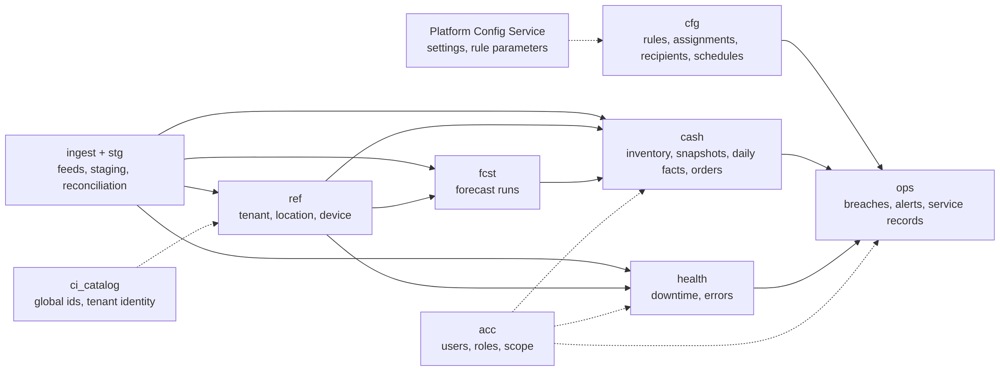
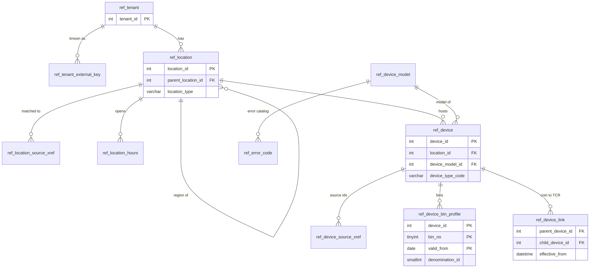
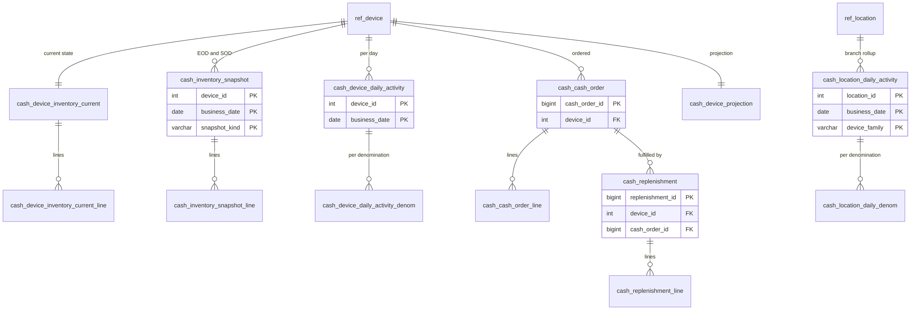
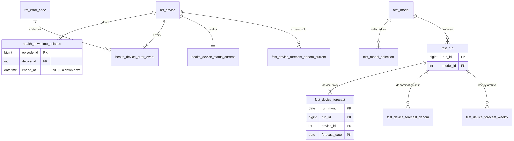
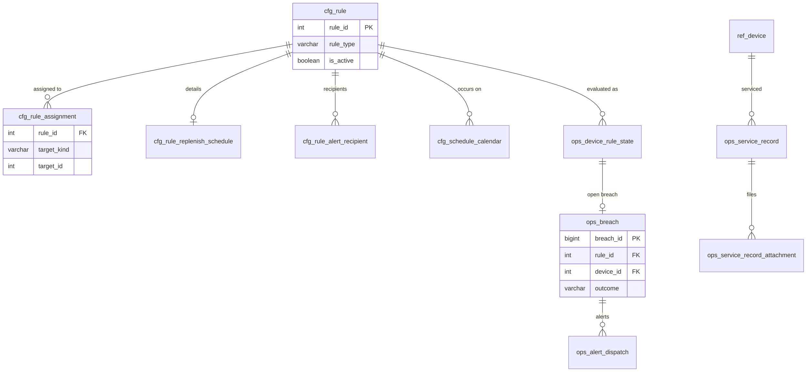
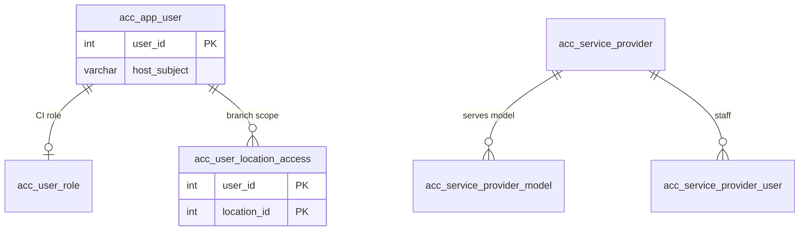
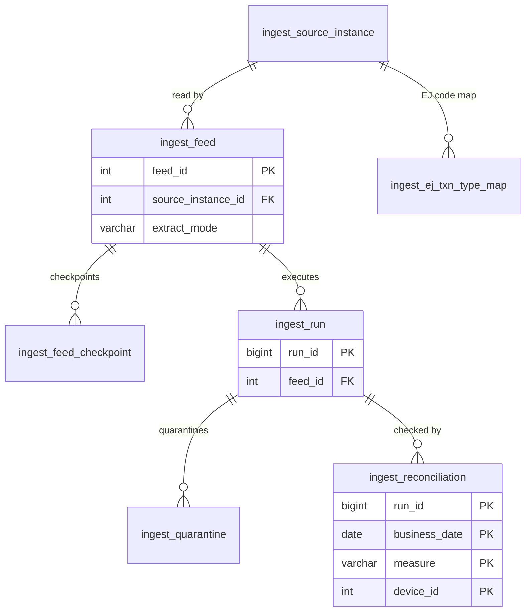

# 3. Schema map and data flow

> **Approved architecture: the R1 design baseline (DEC-006).** Approved by the Cash Intelligence architecture owner on 2026-11-05, after the 2026-11-03 design review. Generated specs follow it; a spec that needs something different is a change here first (GOV-CI-004 in `projects/branch-automation-cash-intelligence/05-delivery/delivery-model-and-gates.md`). Open questions (§16) stay open until answered. Section numbers (§n), open questions (Qn) and decisions (A–I) use the architecture's own numbering; `products/cash-intelligence/architecture/architecture-overview.md` maps each section to its file, and the open questions are in `products/cash-intelligence/architecture/open-questions.md`. Citations: `BAP-nn` = `SRC-JIRA-BAP-001`, `TDD:n` = line n of `SRC-XR-TDD-001`, `research/nn` = `SRC-CI-RES-001` (see the source index).

## 3.1 Schema map

The map is split by area so each diagram stays readable. Table names are the MySQL names (area prefix + table);
only key columns are shown, and every key also carries `tenant_id` as described in §15. Full column lists are in the
sections named under each diagram.

**Areas and how they depend on each other**

Dotted lines are access control (acc scopes what each request can read), configuration read from the platform, and
the control-plane catalogue. Every area lives in each tenant's own database except `ci_catalog`, which also holds the feed control tables (`ingest.source_instance`, `feed`, `feed_checkpoint`, `feed_lease`, run headers and unrouted quarantine; §14.1) and the job leases and change signal (§14.2). `ci_catalog` holds the masters of `ingest.source_instance` and `ingest.ej_txn_type_map`; each tenant database keeps a read-only copy of only the source instances that route to that tenant and their EJ type maps, written from the catalogue by ci-ingest on every change signal (only the ingest role can write the copy), for its keys and joins. A source instance with a routing key in the catalogue (an iQ client, a CO `TenantId`) is copied by that key; an EJ source instance has none, so onboarding adds it to its tenant's copy and the refresh keeps it current.

**Reference data** (§6)

**Cash facts** (§7, §9.4)

**Device health and forecasting** (§8, §9)

**Configuration and operations** (§10)

**Access** (§11)

Page queries join the views `acc.v_user_device_scope`, `acc.v_user_location_scope` and `acc.v_user_rollup_scope`,
derived from these tables, on the caller's `user_id` (§11).

**Ingestion and reconciliation** (§5)

| Schema | Area | Section |
|---|---|---|
| `ref` | Tenant, location hierarchy, device registry, bin profiles, denominations, error catalog | §6 |
| `ingest`, `stg` | Source instances, feeds, checkpoints, runs, reconciliation, quarantine; transient per-source staging | §5 |
| `cash` | Current inventory, snapshots, daily activity, orders, replenishments, projections | §7, §9.4 |
| `health` | Downtime, errors, device status | §8 |
| `fcst` | Forecast models, runs, device forecasts, weekly archive, current denomination split | §9 |
| `cfg` | Rule identity, assignments, alert recipients, replenish schedules, schedule calendar (settings and rule parameters are in the Platform Config Service) | §10 |
| `ops` | Service records, rule state, breaches, alert outbox, user-entered balances, recompute queue | §10 |
| `acc` | User cache, CI roles, bootstrap role rule, location access, service providers, scope views | §11 |
| `ext` | External series (R2) | §12 |
| `audit` | Audit log | §13 |
